 

 

  

> *"Cửa hàng tiện lợi cuối đường Số 9 tuyển người trực ca đêm, trả tiền mặt ngay khi hết ca.*
> *Chỉ cần đọc kỹ tờ quy tắc và tuân thủ nó. Nghe thì đơn giản, phải không?"*

 

[**Giới thiệu**](#-giới-thiệu) •
[**Tính năng v1.7**](#-tính-năng-nổi-bật-v17) •
[**Điều khiển**](#-điều-khiển) •
[**Diễn biến**](#-diễn-biến-một-đêm) •
[**Công nghệ**](#-công-nghệ) •
[**Cài đặt**](#-cài-đặt--chạy-game)

